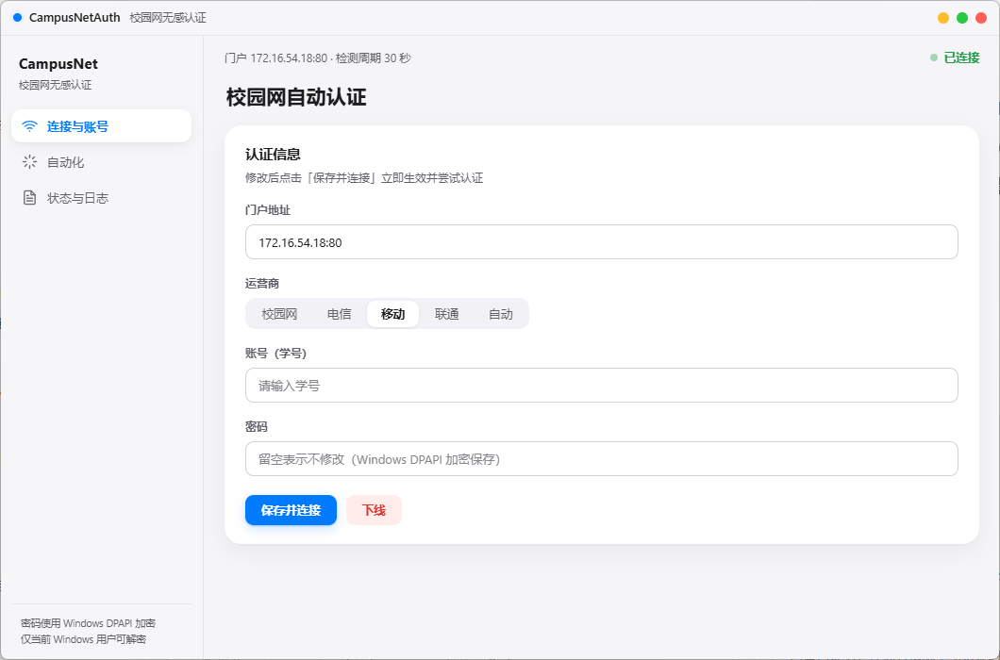

# 校园网无感认证 · CampusNetAuth


> **校园网自动认证征召**
>
> 校园网，我们的家园。
> 通畅，联网。
> “你好啊！”
> 网络，我们的生存正道。
> “噢，你好！”
>
> 但网络，也有代价。
>
> *（弹窗跳认证页面）*
> “不，我的便捷认证啊 —— 不 ——！！！”
>
> **【认证入侵】**
>
> 哈哈，觉得眼熟？
> 这样的场景，此时此刻，全校园各处都在上演！
> 下一个，可能就是你。
>
> 除非，你做出生命中最重要的决定。
> 向自己证明，你拥有摆脱手动认证的力量与勇气！
> 加入…… 自动认证程序！
> 成为精英自动认证者！
> 消灭各式各样的网页弹窗！
> 将免手动认证的便利，传遍整个校园！
>
> 成为英雄！
> 成为传奇！
> 成为自动认证使用者！

开机自动登录校园网，断线静默重连，全程无窗口、无弹窗、无感知。
针对本机门户 `http://172.16.54.18/`（**锐捷 ePortal / SAM+**）逆向适配，运行时零第三方依赖。

> **声明**：本仓库代码全部由 AI 编写，阅读源码时请谨慎（你可能会感到红温）。
> 参与 AI：**DeepSeek V4 Flash**（主要代码）· **DeepSeek V4 Pro**（精细修理）· **Hy4 Preview**（部分精细修理）

---

> **维护者 / 接管的 AI 请注意**：动手之前先读 **[AGENTS.md](AGENTS.md)**——最高优先级的项目规则、
> 安全红线、验收清单、发布流程与**按版本汇报的进度表**。本 README 面向使用者；两者冲突时以
> `AGENTS.md` 为准。

---

## 面向校园

**湖北工业大学 iHBUT**（Hubei University of Technology）校园网。

## 功能特性

- **无感认证**：开机自启 → 后台守护 → 断线自动重连，全流程免干预
- **秒级响应**：事件驱动守护，网络变化 / 被踢下线 / 登录假成功均即时触发
- **异常自愈**：门户偶发「假成功 / 残留会话」时自动下线清残留再重登，不用手动折腾
- **升级自愈**：换新版本后自动重启后台守护让新功能生效；更高版本放进目录即可一键就地升级
- **桌面通知**：自动修复、认证异常等关键事件弹一次右下角系统通知（60s 去重，不刷屏）
- **单文件交付**：一个 exe = 管理界面 + 后台守护 + 开机自启 + 命令行工具，免安装 Python
- **一体化服务**：自启、守护、界面全部由同一个 exe 承担，不再安装/释放 VBS 组件
- **版本检查**：自动查询 GitHub 最新 Release（只看不下载），发现新版本时提示并打开发布页
- **自绘现代 UI**：Apple 风格毛玻璃界面，无边框、无黑窗，支持拖拽与 Aero Snap
- **凭据安全**：密码经 Windows DPAPI 加密，绑定当前用户，文件被拷走也无法解密
- **零第三方依赖**：运行时零第三方库，打包后无需任何 Python 环境

## 系统要求

- **Windows 10 / 11**（x64），需 [Microsoft Edge WebView2 运行时](https://developer.microsoft.com/microsoft-edge/webview2/)（Windows 11 与多数 Windows 10 已内置）
- 仅限 **湖北工业大学 iHBUT** 校园网内使用：程序只在门户 `172.16.54.18` 可达时动作，校外静默待命
- 免安装 Python、免管理员权限（开机自启走当前用户注册表 Run 键）

## 快速开始（单 exe 版）

| 步骤 | 操作 | 说明 |
|---|---|---|
| 1 | 双击 `CampusNetAuth.exe` | 打开无边框管理界面（自绘标题栏，可拖拽/最小化/最大化/关闭） |
| 2 | 界面里填账号密码 →「保存并连接」 | 立即认证 |
| 3 | 进入「自动化」打开「开机后自动认证」开关 | 写入开机自启并拉起后台守护，全部在 UI 内完成 |

> **首次使用建议先在 UI 工具箱点「一键体检」**：会真实断网一次验证自动重连是否可用，
> 全过程约 1 分钟，结果写入 `campusnet.log`；或命令行 `CampusNetAuth.exe test` 查看环境。

## 命令一览

> 打包版用 `CampusNetAuth.exe`；源码开发态用 `python campusnet.py`，命令完全一致。

| 命令 | 作用 |
|---|---|
| （无参） | 打开图形管理界面（双击即用） |
| `setup` | 交互式配置（门户地址、账号、服务、密码） |
| `install` / `uninstall` | 开启 / 关闭开机自启（注册表 Run 键直接运行 `CampusNetAuth.exe daemon`，并拉起守护） |
| `start` / `stop` | 启动 / 停止后台守护 |
| `daemon` | 前台运行守护（调试用） |
| `once` | 检测一次，未认证就登录一次（可配合任务计划定时轮询） |
| `login` / `logout` | 立即登录（`--force` 已在线也重登）/ 下线 |
| `status` | 查看状态：是否在线、服务、自启与守护进程状态 |
| `log [-n N]` | 打印最近 N 行日志（UTF-8 读取，不乱码） |
| `test` | 自检：RSA、门户连通、登录页获取 |
| `upgrade` | 就地升级到程序目录里的新版本并重启守护；`--check` 只体检不改动（守护版本 / 升级候选 / 上次远端检查结论） |
| `update` | 检查 GitHub 最新 Release（只检查、不下载）；`--force` 跳过缓存，`--open` 发现更新时打开发布页 |
| `uninstaller` | 打开（必要时先释放）内置的彻底卸载程序 `CampusNetAuthUninstall.exe` |

## 管理界面



HTML 现代 Web 风格（本地 HTTP 服务 + 原生 Edge WebView2 窗口，单进程零额外依赖）。
窗口无边框自绘：顶部毛玻璃标题栏、Apple 交通灯式按钮，
按住标题栏任意位置可拖动，双击切换最大化，边缘可拖拽调大小，支持 Aero Snap。
若 pywebview / WebView2 不可用（异常环境），自动回退 tkinter 版（`ui.py`），功能不变。

| 分页 | 可设置 |
|---|---|
| **连接与账号** | 门户地址、运营商（校园网/电信/移动/联通/自动）、账号、密码，立即连接或下线 |
| **自动化** | 开机自动认证开关；守护进程管理（状态与 PID、启停/重启）；程序维护（一体化服务状态、自动/手动检查 GitHub Release、彻底卸载）；检测周期、重试间隔、退避上限、超时；工具箱（自检 / 一键体检 / 打开目录 / 抓取诊断 / 通知测试） |
| **状态与日志** | 实时网络状态、账号、服务、IP、自启与守护状态，刷新 / 立即检测 / 下线，深色终端风格日志区 |

细节约定：

- 密码输入默认掩码，可点「显示」临时查看；保存走 **Windows DPAPI** 加密，界面不回显已保存密码（留空即不修改）。
- 联网操作均在后台线程执行，按钮禁用并显示旋转进度指示，不卡窗口；提示用界面内气泡通知，不用系统弹窗。
- **守护只在 iHBUT 校园网内动作**：每次循环先探测门户（`172.16.54.18`）是否可达，不可达（家里/热点/公共 WiFi）就静默等待、绝不尝试认证；只有门户可达且未认证时才自动登录。
- **单文件便携 + 一体化服务**：交付物只有 `CampusNetAuth.exe`，开机自启直接指向它（`daemon` 参数），界面与守护也是同一个 exe，不再安装任何 VBS 组件。旧版部署残留的 `CampusNetAuthDaemon.vbs` / `CampusNetAuthUI.vbs` 不影响使用，启动时会自动把旧 Run 键迁移为直接运行 exe，彻底卸载时一并清理。全新部署且目录非空时提醒一次"建议放入空文件夹"。
- 所有配置文件放在 exe 所在目录（`config.json` / `cred.bin` / `state.json` / `daemon.pid` / `campusnet.log`），整个文件夹拷走即迁移。
- 首次启动约 10~15 秒（onefile 解压 + WebView2 初始化），二次启动更快；需要 Edge WebView2 运行时（Windows 10/11 自带）。

## 彻底卸载

`CampusNetAuth.exe` 是单文件便携程序，**"删掉 exe"并不等于卸载干净**：守护进程、
开机自启注册表项、解包缓存都还在。更麻烦的是 Windows 的硬规矩——**正在运行的
exe 无法删除自己**（文件被映像段锁住），所以彻底卸载必须由**另一个 exe**来完成。

因此 exe 里内置了一个约 20KB 的独立卸载程序，**你第一次打开主程序时它会自动释放到
同目录**（`CampusNetAuthUninstall.exe`），也可以在界面「自动化 → 程序维护 → 彻底卸载」
点一下打开，或命令行 `CampusNetAuth.exe uninstaller`。

它做的事（有确认窗口，也可以 `--silent` 静默跑）：

| 步骤 | 内容 |
|---|---|
| 1 | 终止**本目录下**的全部本程序进程（含 onefile 的引导父进程——它持有 exe 文件句柄，不杀掉就删不动文件，这正是"卸载删不掉"的根因） |
| 2 | 删除 `HKCU\...\Run\CampusNetAuth` 自启项 —— 仅当它指向本目录或已失效；指向另一份安装时保留 |
| 3 | 清理 `%TEMP%` 下属于本程序的 `_MEI*` 解包残留 —— **正在被使用的（另一个实例还在跑）整体跳过，一个文件都不动** |
| 4 | 删除程序文件、日志与轮转、状态/凭据、`.webview2-cache`、`probe` 等全部产物 |
| 5 | 目录里若有你自己的文件，**目录保留**（只删本程序的东西）；最后把自己也删掉 |

```bat
CampusNetAuthUninstall.exe              图形确认后彻底卸载
CampusNetAuthUninstall.exe --silent     静默（退出码 0=干净 / 1=有残留）
CampusNetAuthUninstall.exe --keep-data  保留账号配置与凭据（config/cred/state）
CampusNetAuthUninstall.exe --report=C:\unins.txt   写出清理明细（排障/取证用）
```

> 进程判定一律按**映像文件全路径**，绝不按进程名杀——同名多份部署很常见，
> 按名字杀会误伤你放在别处的另一份程序。

## 配置文件 `config.json`

| 字段 | 默认 | 说明 |
|---|---|---|
| `portal_host` | `172.16.54.18` | 门户地址 |
| `portal_port` | `80` | 端口 |
| `portal_base` | `/eportal` | 门户接口路径前缀 |
| `username` | （空） | 学号（`config.example.json` 里为示例 `1234567890`） |
| `service` | `default` | 服务：`default`校园网 / `DX`电信 / `YD`移动 / `LT`联通 / `auto`自动 |
| `interval` | `30` | 在线时的检测周期（秒），即掉线后最长多久自动重连 |
| `retry_interval` | `30` | 登录失败后的重试间隔，指数退避 |
| `max_interval` | `600` | 退避上限（秒） |
| `offline_interval` | `60` | 网络完全不可达时的检测周期 |
| `timeout` | `8` | 单次 HTTP 超时（秒） |
| `probe_timeout` | `3` | 连通性/门户探测超时（秒），网络差时快速判定 |
| `keepalive_interval` | `300` | 在线续约会话间隔（秒），防认证过期被踢 |
| `verify_interval` | `5` | 登录成功后即时确认等待（秒）：防网关"假成功" |
| `recheck_interval` | `30` | 校外/断网退避期间的环境快探间隔（秒），网络恢复即时响应 |
| `logout_pause` | `600` | 手动「下线」后的静默期（秒）：用户显式下线后守护不自动登回；`0` = 关闭（旧行为：下线后 30s 内被登回）。界面「立即连接」或 `login` 会立刻解除静默期 |
| `detect_targets` | 3 个 | 连通性检测目标（HTTP，避免 HTTPS 证书干扰） |
| `login_page_hints` | `wlanacname/logic` + `nasip/10.253.0.17` | 登录页兜底参数：未认证时若网关不做 302 劫持（未认证阶段 DNS 直接被黑洞），程序会按 `wlanacname` + `nasip` + 本机 IP/MAC 自行拼出带 queryString 的登录页 URL。取值方法：浏览器登录一次，把地址栏 `index.jsp?` 后面的参数抄过来（`wlanacname`/`nasip` 必须与 SAM+ 里登记的 portal 设备一致，否则门户只会回「WEB认证设备未注册」）。`wlanuserip`/`wlanparameter` 留空则用本机地址自动填充；置为 `{}` 或 `false` 关闭兜底 |
| `pin_pubkey` | `true` | 门户公钥 pinning（TOFU）：首次登录成功后记住门户 RSA 公钥指纹，之后指纹变化或门户突然不要求加密都会**拒绝发送凭据**；学校换密钥时删 `state.json` 的 `portal_pubkey_fp` 重新锚定 |
| `log_level` | `INFO` | 日志级别 |

密码**不写进** `config.json`，单独用 **Windows DPAPI** 加密存 `cred.bin`，
只有当前 Windows 用户能解密，换用户/换机器自动失效。
仓库提供 `config.example.json` 模板，复制为 `config.json` 后填写自己的账号即可。

## 工作原理（逆向结论）

| 环节 | 结论 |
|---|---|
| 门户类型 | 锐捷 ePortal（SAM+），接口前缀 `/eportal/InterFace.do?method=` |
| 登录接口 | `POST /eportal/InterFace.do?method=login` |
| 在线检测 | 访问外网 HTTP 目标，被 302 到门户即为未认证 |
| 登录页获取 | 跟随该 302，页面隐藏字段含 RSA 公钥；网关不劫持时按 `login_page_hints` 自拼 |
| 密码明文 | `<密码> + ">" + <queryString 里的 mac>`（无 mac 时按门户口径用 `111111111`） |
| 加密开关 | 先看登录页隐藏域；新版页面把 `passwordEncrypt`/公钥留空时，按页面 JS 同样的方式向 `pageInfo` 取 |
| 加密流程 | 明文整体**反转** → **教科书 RSA**（无 PKCS#1 填充，16-bit 小端分块打包） |
| RSA 公钥 | 登录页 `publicKeyExponent` / `publicKeyModulus`，**每次登录动态读取** |
| 参数编码 | 每个字段 `encodeURIComponent` **两次** |
| 状态接口 | `getOnlineUserInfo` / `pageInfo` / `getServices` / `keepalive` |

### 为什么可信

RSA 加密是这套协议里唯一容易写错的地方（无标准填充，字节打包方式特殊）。
已用 **Node 执行门户官方 `security.js`** 与本地 Python 实现逐字节对拍：

```
[1] 'Test@123456>7AB3405C36D0'            一致
[2] 'abc123>'                             一致
[3] 'a'                                   一致
[4] '1234567890>7AB3405C36D0'             一致
[5] 'P@ssw0rd!#$%^&*()>00-11-22-33-44-55' 一致
[6] 'x'*126  (刚好一块，不补零)             一致
[7] 'y'*127  (跨块)                        一致
```

（对拍临时脚本未随仓库分发；`probe/` 只保留抓包证据脚本。）
仓库内可随时用内置自检复核 RSA 正向加密：`CampusNetAuth.exe test`
（或开发态 `python campusnet.py test`）——用一组固定 1024-bit 密钥跑
`eportal_rsa_encrypt`，并顺带检查门户连通性与在线状态。

## 即时响应机制

登录页发现会优先读取当前探测得到的门户重定向；命中有效页面后不再预先请求三个备用路径。首选页面不可用时才逐个回退，直接取得的页面不会重复读取。同一次发现中的地址会去重，Cookie 保持连续，动态认证参数每次重新取得、不跨次缓存。候选页面仅接受配置门户同主机、同端口的 HTTP 地址（当前客户端使用 HTTP）；异常地址或其他站点的重定向不会携带会话访问。门户根路径上的**后台管理登录页**（form action 指向 `admin.do`）不会被当成学生登录页，避免把学生密码提交到管理台接口。三个备用路径都给不出登录页时，v0.5.4 起按 `login_page_hints`（`wlanacname` + `nasip` + 本机 IP/MAC）自行拼出带 queryString 的登录页 URL 再校验，校外网络（门户不可达）不会触发这次追加请求。
公网探测全部失败只表示探测无结论，不等于校园网门户不可达。守护和 once 会继续复核配置的门户：已有明确在线会话时不重复登录；否则只有发现同门户的有效登录页、当次 queryString 及完整加密字段（或明确的非加密密码表单）才进入正常认证。普通 HTTP 200 或字段不完整不会触发凭据提交。页面只在当前尝试内复用，原有公钥 pinning、加密和登录后确认保持不变；没有足够证据时使用非零、有上限的退避，不因门户持续可达而反复清零失败计数。等待中探测恢复出明确结果或收到 CHECK 会提前复核，STOP 仍可中断等待。

守护被设计为"事件驱动 + 秒级响应"，三类机制协同工作：

1. **未认证当轮立即认证**：`check_online()` 返回未认证 → 当轮零等待调用 `login()`，
   不进入任何退避（打开校园网浏览器 → 下一秒就通）。
2. **状态变化秒级发现**：

   | 场景 | 旧延迟 | 新机制 |
   |---|---|---|
   | 断网重连 / WiFi 切换 / 从校外回校 | ≤30s 轮询 | **秒级**：`NotifyAddrChange` 监听网络地址变化，通知守护立即复核 |
   | 在线期被踢下线（IP 不变） | ≤30s | 30s 轮询 + `keepalive` 失败复核兜底 |
   | 登录后假成功（门户残留会话） | 每 5s 重登、**永远上不了网** | **5s 内复核 → 主动下线清残留 → 下一轮重新认证**，并弹一次系统通知 |
   | UI 手动操作 | ≤30s | **秒级**：UI 发 `CHECK` 唤醒等待中的守护 |

3. **状态事件即时反馈**：守护状态翻转写入 `state.json` 的 `events` 环形缓冲
   （最近 8 条，同 kind+msg 60s 内去重），前端"最近动态"卡片展示最近 3 条。

### 门户「残留会话」自愈（v0.4 新增）

学校门户偶发异常：**登录接口返回 `success`，会话却没有真正建立**（账号页有效期会
显示 1970 之类的异常值）。此时上一次的失效会话仍挂在门户上，直接重登会被当成
"该账号已在线"而不生效——表现为"每隔几秒登录一次、却始终上不了网"的死循环。

程序对此的处置链（`campusnet.py` 守护循环内）：

```
login() = success
      ↓ 等 verify_interval(5s)
check_online() = False ?  ──否──→ 正常在线，进入常规周期
      ↓ 是（假成功）
1. 立即推送一次系统通知（同段异常内只提醒一次，不刷屏）
2. 写一条 portal_fix 事件到 state.json（界面「最近动态」显示 ⚠）
3. logout(force_by_cred=True) 主动下线，清掉门户侧残留会话
4. 2s 后回到循环顶部重新认证（连续 ≥3 次则转为按次数指数退避）
```

复核通过后自愈计数清零，下次再出现异常仍会重新提醒一次。

> 判定用的是**行为**（登录成功 + 5s 后复核失败）而不是字段，因为
> `getOnlineUserInfo` 响应里**根本没有有效期字段**（已用 `dump_online_info.py`
> 抓包实证），靠字段判断不可靠。

若异常持续出现，可在校园网内跑 `python dump_online_info.py --relogin` 抓一次
门户的完整响应（含时间类字段扫描），把输出附到 Issue 里便于定位。

### 实现要点

- **CHECK / STOP / NOTIFY 协议**：`127.0.0.1:47667`（单例锁端口），守护用 `select` 监听
  socket 数据（替代 `time.sleep`），`STOP`=优雅退出、`CHECK`=立即复核一轮、
  `NOTIFY`=让守护进程自己发一条测试通知（不打断等待）。
- **系统通知（右下角）**：纯 `ctypes` 调 `Shell_NotifyIconW`，临时注册 message-only
  窗口 + 托盘图标 + 消息泵，零子进程、零第三方依赖，失败静默降级（通知只是锦上添花，
  绝不影响认证）。**关键前提**：必须先 `SetCurrentProcessExplicitAppUserModelID`
  ——没有 AUMID 的进程发通知会被 Windows **静默丢弃**（API 返回成功但什么都不显示），
  这是踩过的坑。同标题+正文 60s 内去重，避免异常持续期间刷屏。
- **通知测试（工具箱）**：一次点击验证三条通道——① 界面气泡、② 界面进程的系统通知、
  ③ **守护进程的系统通知**。为什么要单独测守护：AUMID 与托盘图标都挂在**发出进程**上，
  界面能弹不代表无人值守的守护也能弹；③ 走 `NOTIFY` 指令由守护自己发出，
  即"界面没开也在跑"的真实场景。
- **自启直接指向 exe**：Run 键命令为 `"<程序目录>\CampusNetAuth.exe" daemon`，
  不再经 VBS 中转；`--windowed` 构建本身没有控制台，开机不会闪黑窗。
- **自启健康检查**：`autostart_health()` 解析 HKCU Run 键 → 校验 exe 是否齐全，
  前端在自启启用但链路残缺时显示红色警示条；安装前也做前置校验，杜绝残缺自启。
- **自启自愈与旧版迁移**：目录被搬到新位置、或 Run 键指向的旧 VBS 已丢失时，
  从新位置打开管理界面会自动把 Run 键改写为当前 exe（`repair_autostart_cmd()`，
  仅打包态）；旧版仍有效的 wscript+VBS 也会就地迁移。指向另一份仍然存在的安装时
  不动作，测试副本/多副本不会被劫持。
- **退出临时目录清理**：单文件 exe 退出时 PyInstaller 清理 `%TEMP%\_MEIxxxx`
  可能因 WebView2 子进程占用而弹 "Failed to remove temporary directory"——
  已双管齐下：退出前等待本程序 WebView2 子进程结束 + 每次启动自动清扫超 1 小时的
  `_MEI*` 残留（见 `desktop.py` / `campusnet.py`）。

## 升级

### 为什么不能"直接覆盖"exe

后台守护**不是独立程序**，而是「同一个 `CampusNetAuth.exe` + `daemon` 参数」的
另一个进程（任务管理器里两个同名进程属正常）。由此带来两个必须处理的问题：

| 问题 | 现象 | 处理 |
|---|---|---|
| **文件被锁** | 守护/界面在跑时，Windows 会锁定 exe 文件。实测覆写报 `WinError 32`（另一个程序正在使用此文件），**拖拽替换直接失败** | 程序自己换：停止守护 → 旧文件让位（重命名，运行中也允许）→ 新文件就位 → 拉起新守护 |
| **守护版本滞后** | 换完文件后，已在跑的守护仍是旧版本的代码镜像，新功能不会生效（用户毫无察觉） | 控制通道 `VER` 版本握手 + `state.json` 版本落盘；界面启动时发现陈旧就**自动重启守护** |

> 0.6.0 起自启直接指向 exe，旧版 VBS 启动器**不需要重装**——打开一次新版本界面
> 就会把 Run 键自动迁移为直接运行 exe。

> **"守护关了却删不掉文件"？** 那是 onefile 的**引导父进程**还活着（子进程被停掉，
> 父进程仍在等它并持有 exe 文件句柄）。v0.5.2 起 `stop_daemon` 会按 `daemon.pid`
> 记录的「自身 PID + 父进程 PID」连同端口占用者一起收尾，并且**停机没干净时保留
> `daemon.pid`**（它是下次找到残留进程的唯一线索）。要彻底清干净，直接用
> [彻底卸载](#彻底卸载) 里的内置卸载器——它按**映像文件全路径**认领进程，不误伤别处
> 的另一份部署。

> 卸载器同样随主程序升级：每次打开界面时按大小比对，发现旧的就刷新同目录的
> `CampusNetAuthUninstall.exe`；它不携带版本资源，因此绝不会被"发现新版本"逻辑
> 误当成升级候选。

### 先检查有没有新版本

程序**只检查、不自动下载**（避免在后台静默替换正在运行的 exe）：

- 打开界面后会自动查询一次 GitHub 最新正式 Release；「自动化 → 程序维护 → 版本更新」
  可随时手动点「检查更新」；
- 发现新版本时，后台守护卡片上方会出现提示条，点「打开发布页」用系统浏览器打开；
- **检查结果会落盘**（`state.json` 的 `update_last`）：命令行 `status` / `upgrade --check`
  在新进程里也能看到上次结论与检查时间，不再永远显示"未检查"；
- 启动时那次检查若因未认证失败，**认证成功后会在线自动补查**（失败满 5 分钟、成功满
  6 小时才重查；离线时不发请求），卡片副标题同时显示上次检查时间与失败原因；
- 命令行等价操作：`CampusNetAuth.exe update`（`--force` 跳过缓存，`--open` 打开发布页）。

> 检查失败不影响认证：网络不可用 / GitHub API 限流时只显示"检查失败"，
> 成功结果缓存 6 小时、失败缓存 5 分钟，不会反复请求；界面开着时会等在线后自动补查。

### 推荐升级方式（v0.5 起）

1. 从 Release 下载新的 exe（可从上面的发布页进入），**放进程序所在文件夹**
   （与旧版同名时 Windows 会自动存成 `CampusNetAuth (1).exe`，无需改名）；
2. 打开管理界面 → **自动化 → 后台守护**，会看到「发现新版本 vX.Y.Z」提示条；
3. 点「**立即升级**」——程序自动停守护、换文件、用新版本重启守护；
4. 关掉并重新打开界面，完成。

命令行等价操作：`CampusNetAuth.exe upgrade`（`--check` 只体检不改动）。

### 从 v0.4 及更早版本升级（那时代码里还没有升级助手）

老版本不认识这套机制，需要手动三步：

1. 界面「自动化 → 后台守护」→ 点「**停止守护**」（或 `CampusNetAuth.exe stop`）；
2. **关闭管理界面**（界面进程同样锁着文件）；
3. 替换 `CampusNetAuth.exe`，重新打开即可。

之后所有升级都用上面的「立即升级」，不必再手动操作。

## 目录结构

```
campus-net-auth/
├─ CampusNetAuth.exe        主程序（单 exe，双击=界面 / daemon 参数=守护 / CLI 子命令）
├─ CampusNetAuthUninstall.exe  彻底卸载程序（约 20KB 的独立 exe，内置于主 exe，
│                              首次打开界面自动释放到同目录；删不掉自己是 Windows 的硬规矩）
├─ campusnet.py             主程序源码（开发态用，零依赖）
├─ desktop.py               HTML 界面桌面壳（pywebview + Edge WebView2，优先启动）
├─ gui_server.py            HTML 界面后端（零第三方依赖 HTTP 服务 + 内嵌前端）
├─ ui.py                    tkinter 界面源码（HTML 界面不可用时的回退）
├─ e2e_test.py              端到端测试脚本
├─ dump_online_info.py      门户在线信息抓取诊断（排障用，只读不写）
├─ check_ui.py              内嵌前端静态校验（JS 语法 / 标签配对 / id 引用）
├─ smoke_regression.py      冒烟回归（离线，覆盖核心链路；含内置卸载器自动释放）
├─ smoke_uninstall.py       内置卸载器端到端（隔离目录伪造"用过的程序目录"+ 占用
│                           exe 的进程 + 另一个正在运行的实例，断言清得干净且不误伤）
├─ uninstaller/CampusNetAuthUninstall.cs  彻底卸载程序源码（C# WinForms）
├─ build_uninstaller.bat    编译卸载器（系统自带的 csc.exe，输出 build_assets/）
├─ config.json              配置（不含密码，自动生成）
├─ config.example.json      配置模板（发布仓库用，账号为占位符）
├─ cred.bin                 DPAPI 加密的密码（自动生成）
├─ state.json               最近一次登录的会话 ID（自动生成）
├─ campusnet.log            日志（自动生成）
├─ 管理界面.bat / 一键测试.bat / 安装.bat / 卸载自启.bat / 查看状态.bat / 抓取诊断.bat
├─ CampusNetAuthUI.vbs / CampusNetAuthDaemon.vbs  旧版启动器（0.6.0 起不再释放，
│                           仅保留在仓库用于兼容旧部署；启动时自启会自动迁移）
├─ build_exe.bat            一键重新打包（--onefile --windowed）
├─ _pyinst_wrap.py          打包包装（绕过 sitecustomize shim + 生成版本资源）
├─ tests/                   单元测试（零网络，CI 跑）
├─ .github/workflows/       CI（windows-latest：语法 + 编译卸载器 + 卸载器端到端 + 单测 + 前端 JS 检查）
└─ probe/                   抓包诊断运行输出（capture_result.json 等，自动生成）
```

## 构建（开发者）

构建依赖见 **`requirements-dev.txt`**（exe 运行时零第三方依赖，仅构建需要）：
`python -m pip install -r requirements-dev.txt` 装进你的构建解释器即可。
解释器不合适可用环境变量覆盖：`CNA_BUILD_PYTHON`（构建用 python）与
`CNA_PY_SITE`（PyInstaller 所在 site-packages，一般不用设）。
本机个性化路径请放 `_build_local.bat`（已被 `.gitignore` 忽略），别写进仓库文件。

双击 **`build_exe.bat`** 一键重建。内部 `python -E -S _pyinst_wrap.py` 启动
PyInstaller，产物在 `dist\CampusNetAuth.exe`（fresh build），随后复制到项目根。
exe 版本资源由 `_pyinst_wrap.py` 从 `campusnet.py` 的 `APP_VERSION` 自动生成。

`build_exe.bat` 会先调用 **`build_uninstaller.bat`** 编译内置卸载器
（`uninstaller\CampusNetAuthUninstall.cs` → `build_assets\CampusNetAuthUninstall.exe`），
再用 `--add-data` 把它塞进主 exe（0.6.0 起不再内嵌 VBS 启动器）。卸载器刻意用 **C# + .NET
Framework** 而不是 PyInstaller 再打一个包：只有约 20KB（要塞进主 exe，每 MB 都翻倍
在下载体积上）、**自己不解压就不留 `_MEI` 残留**、且 `csc.exe` 是 Windows 10/11 与
CI 运行器自带的，用户侧无需任何额外运行时。编译不通过时构建直接失败，不会产出
"缺卸载器"的 exe。`CNA_CSC` 可覆盖编译器路径。

`_pyinst_wrap.py` 的存在原因：本项目的开发环境（WorkBuddy）会在 `sitecustomize`
中劫持 `os.remove` 到回收站 API，导致 PyInstaller `--clean` 阶段失败但静默退出
（看似成功、`dist/` 却为空）。`-E -S` 跳过 site.py 使劫持不生效，wrapper 再手动
把构建解释器的 site-packages 加回 `sys.path`。

日志在 `campusnet.log`，排障先看它。

### 关于中文编码（改 `.bat` 前必读）

所有中文文案**只放在 Python 文件里**（UTF-8），**不要往 `.bat` 里写中文**——
`cmd.exe` 切换代码页后按「字符偏移」定位批处理文件，含中文的行会被错位读取。
现有 `.bat` 均为纯 ASCII；打包版为 GUI 子系统（`--windowed`）零黑窗；
CLI 从 cmd 运行时通过 `AttachConsole` 附加父控制台并按代码页输出中文。
日志按 UTF-8 写入，查看请用 `python campusnet.py log`（内部显式 UTF-8 读取），
**不要**用 `type` / `Get-Content` 直接读（会按 GBK 解码成乱码）。

## 安全说明

完整的安全政策（支持范围、漏洞上报渠道、数据保护）见 **[SECURITY.md](SECURITY.md)**。核心要点：

- 密码用 Windows DPAPI（`CryptProtectData`）加密，绑定当前用户账户，文件被拷走也无法解密。
- 所有请求走校园网内网 HTTP，凭据只发给门户服务器 `172.16.54.18`。
- 不会在任何地方打印明文密码；日志里的账号默认做脱敏。
- 程序只做"自己的账号自动登录"，不做任何绕过计费或共享账号的行为。

## 常见问题

| 现象 | 原因 / 处理 |
|---|---|
| 提示"尚未配置账号密码" | 先跑 `CampusNetAuth.exe setup` 或界面里填账号密码 |
| 登录失败：账号或密码错误 | 密码错了，重跑 `setup`；注意门户可能限制错误次数 |
| 登录失败：在线设备数超限 | 网页端先踢掉其它在线设备 |
| 登录失败：密码含中文 | 门户 JS 库对此处理有缺陷，建议改成纯 ASCII 密码 |
| 任务管理器里守护显示为 CampusNetAuth.exe | 正常：守护是「同一 exe + daemon 参数」后台运行，一界面一守护共两个同名进程 |
| 一直"网络不可达" | 分两种：**真的不在校园网**（如家里 WiFi，门户不可达）属正常，程序只等待；若状态写的是"**公网探测无结论（门户可达）**"，说明探测外网的那三个目标不可达（常见于未认证时 DNS 被挡），而校园门户是好的 —— 此时守护会直接按门户判定并认证，不再空等 |
| 日志反复"页面不满足认证条件"、累计登录成功一直为 0 | 未认证阶段网关不做 302 劫持且 DNS 被黑洞时，程序拿不到带 queryString 的登录页；v0.5.4 起会按 `config.json` 的 `login_page_hints` 自己拼。先跑 `status` 看"登录页兜底"是否"已配置"；若仍是兜底无效，用浏览器登录一次，把地址栏 `index.jsp?` 后面的参数（尤其是 `wlanacname` 与 `nasip`）抄进 `login_page_hints` |
| 开机完全没反应、`autostart.log` 里写 `daemon NOT started: exe missing` | **exe 被杀毒软件删了**（最常见：Defender 对 PyInstaller 单文件 exe 的启发式误报，如 `Trojan:Win32/Bearfoos.B!ml`）。处理：Windows 安全中心 → 病毒和威胁防护 → 保护历史记录 → 找到该条 → **还原**；再把程序目录加进「排除项」（`添加或删除排除项` → 文件夹）。换程序目录后排除要重新加。可用事件查看器核对：`Microsoft-Windows-Windows Defender/Operational` 的 1116/1117 事件会写明命中路径 |
| 点了「下线」很快又自己连上 | 旧版本行为：守护 30s 内发现未认证就重登，`logout` 形同虚设。v0.6.1 起下线会进入 `logout_pause` 静默期（默认 600s，`status` 会显示剩余时间）；想立刻联网就点「立即连接」或执行 `login` |
| 日志写「无法自动认证：门户登录页已启用验证码 / 要求短信二次验证 / 已改为 CAS」 | 学校把认证方式改了，账号密码自动认证不再可能成功。程序会明确报结论并改为 30 分钟一次的长退避（不再每 30s 反复敲门户），此时只能人工认证 |
| 右下角提示"校园网认证异常" | **正常自愈**：门户偶发「登录返回成功但会话未建立」（残留会话），程序已自动下线清残留并重新认证，通常几秒后恢复；同一段异常期只提醒一次 |
| 反复提示认证异常、始终上不了网 | 可能已不是残留会话问题（如在线设备数超限、账号被限制）。程序会转为按次数退避（不会高频敲门户）；请手动打开认证网页看门户的具体提示 |
| 想确认通知能不能弹 | 工具箱 →「**通知测试**」：一次点击验证三条通道（界面气泡 / 界面进程通知 / **守护进程通知**）。守护那条正是"界面没开也在跑"的场景，最值得测 |
| 完全收不到右下角通知 | Windows 11「设置 → 系统 → 通知」确认通知总开关与"专注助手/免打扰"未拦截；程序的通知应用 ID 为 `CampusNetAuth.Tray`，可在通知设置列表里按此名查找 |
| 开机没自动登录 | 跑 `status` 看自启状态；或看 `campusnet.log` 末尾 |
| 开机弹"Windows Script Host 80070002" | 只有旧版（≤0.5.x）的 VBS 自启会这样：vbs 找不到同目录 exe。打开一次 0.6.0+ 界面会把 Run 键自动迁移为直接运行 exe，旧报错随之消失；UI 也会用红条提示 |
| 界面红色"开机自启将失败"警示条 | 自启指向的 exe 已丢失（目录被搬走/改名），打开界面会自动修正；若仍报错，关闭再重新打开「开机后自动认证」开关 |
| 关闭程序弹"Failed to remove temporary directory" | 根因：UI 用 Popen 拉起守护/诊断等同 exe 子进程时，子进程继承了 PyInstaller 的 `_MEIPASS2`/`_PYI*` 阶段标记，误跳过解压、直接复用 UI 的 `_MEI` 临时目录；UI 退出后引导进程删该目录，子进程还映射着其中 `python313.dll` 等文件 → 删除失败弹窗、目录被掏空。已修复：所有同 exe 子进程启动前剥离这些变量（`clean_pyi_env()`），各自解压私有目录。历史残留的 `%TEMP%\_MEI*` 目录在程序全部退出后可手动删除 |
| 装开机自启报"拒绝访问" | 旧版 `schtasks` 计划任务会被受限环境拒绝；新版用注册表 Run 键（当前用户级，无需管理员），直接运行 exe 的 `daemon` 子命令 |
| 换新版本后提示"文件正在使用，无法替换" | 守护/界面在运行时 Windows 会锁住 exe（`WinError 32`）。先「停止守护」并关闭界面再替换；或直接把新文件放进目录用「立即升级」 |
| 升级后新功能没生效 | 换完文件时仍在跑的守护还是旧版本代码。v0.5 起界面会自动重启陈旧守护（也有「重启守护以生效」按钮）；更早版本请手动重启守护 |
| 后台守护显示"← 旧版" | 版本握手发现守护进程与程序文件版本不一致，点「重启守护以生效」即可 |
| 程序目录里的 `CampusNetAuth.exe.old.exe` | 就地升级留下的旧版本备份，下次启动自动清理；也可手动删（需先退出程序） |
| 守护明明"停了"，exe 却还是删不掉（`WinError 32`） | onefile 的**引导父进程**还在（它持有 exe 文件句柄等待子进程收尾）。用内置卸载器清理：界面「程序维护 → 彻底卸载」或 `CampusNetAuthUninstall.exe`；它会把整个进程族（含该父进程）收掉再删文件 |
| 想彻底卸载、一点残留都不留 | 运行程序目录里的 `CampusNetAuthUninstall.exe`（首次打开主程序时自动释放；也可 `CampusNetAuth.exe uninstaller`）。它会停守护、删自启项、清 `%TEMP%` 解包残留、删程序文件与缓存，最后把自己删掉；目录里你自己的文件与目录本身会保留 |
| 卸载后想保留账号配置 | `CampusNetAuthUninstall.exe --keep-data`（保留 `config.json` / `cred.bin` / `state.json`，下次安装免重填） |
| 卸载报告说"有残留" | 看报告（`--report=<路径>`）里的失败项；常见原因是某进程被权限/杀软拦住未终止，或某文件被别的程序占用。卸载器也会把"另一个正在运行的实例仍占用的解包目录"列为**保留**（不是失败），属预期 |
| 想换地方存放 | 整个文件夹一起移动（配置都在 exe 旁边），移动后打开一次界面即可：自启路径会自动修正为新位置 |
| 直接删掉程序文件夹，注册表里还留着自启项 | 无碍：Run 键指向的 exe 不存在时，Windows 开机会静默跳过（不弹报错）。想清掉可在 Windows「设置 → 应用 → 启动」里把 CampusNetAuth 关掉/删除，或把程序放回原路径再打开界面（自愈会接回） |
| 「检查更新」显示失败 | 只影响提示，不影响认证。常见原因是校园网未认证时无法访问 GitHub、或匿名 API 被限流；认证成功后会自动补查（也可手动再点一次），卡片副标题会写出失败原因与检查时间 |
| 程序目录里还有旧的 `CampusNetAuthDaemon.vbs` / `CampusNetAuthUI.vbs` | 0.6.0 起不再使用，留着不影响运行（启动时自启已迁移为直接运行 exe）；运行「彻底卸载」会一并清理 |
| 双击 exe 闪黑色 cmd 窗口 | 不应发生（`--windowed` 打包）。如仍闪，检查是否被 `cmd /c start` 或 bat 间接拉起 |
| 启动后闪过 Windows Terminal 再消失 | 不应发生。新版已零子进程化（端口查询走 IP Helper API、终止进程走 TerminateProcess）。如仍闪，提交 `campusnet.log` |

---

*项目定位为个人校园网便利工具，仅供学习与自用。采用 [GPL-3.0](LICENSE) 许可：允许学习、修改与再分发（衍生作品须同样以 GPL-3.0 开源）。详见仓库 `LICENSE` 文件。*
